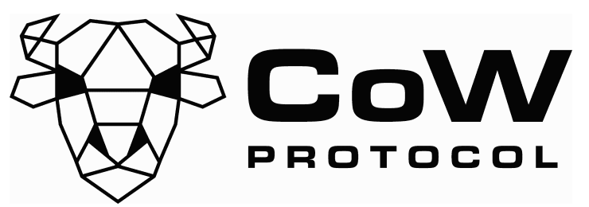

<p align="center">
  
</p>

# Solana Trading SDK

## Test coverage

| Statements                                                                              | Branches                                                                            | Functions                                                                             | Lines                                                                         |
| --------------------------------------------------------------------------------------- | ----------------------------------------------------------------------------------- | ------------------------------------------------------------------------------------- | ----------------------------------------------------------------------------- |
|  |  |  |  |

`@cowprotocol/sdk-trading-solana` is CoW Protocol's Solana settlement client: it turns a quote
into an on-chain `CreateOrder` instruction against the CoW Protocol Solana
settlement program.

**Experimental.** The settlement program (`cow-settlement-interface` / `solana-programs`) is a young,
actively evolving deployment — expect breaking changes to the intent wire format, PDA seeds and this
package's API across minor versions. The currently deployed program id is exported as
[`SOLANA_SETTLEMENT_PROGRAM_ID`](https://github.com/cowprotocol/cow-sdk/blob/main/packages/config/src/chains/const/contracts.ts)
from `@cowprotocol/sdk-config` — see it on
[Solana Explorer](https://explorer.solana.com/address/FYp8R5K4B3B1Kfr7QuWzMz4TwoT7wptjYtxgCrY5sRXb).

```
npm install @cowprotocol/sdk-trading-solana
```

A runnable end-to-end example lives in [`examples/nodejs/solana`](../../examples/nodejs/solana).

## Making a trade

### Step 0 — approve the settlement program as SPL delegate

The settlement program moves funds out of the seller's token account via a CPI, which SPL Token
only allows for an approved `delegate`. Before any order on a given sell-token account can settle,
that account's owner must approve the settlement **state PDA** (not the program id itself) as
delegate, for at least the amount being sold. `approveCowProtocol` builds that instruction without
sending it, deriving the sell-token account and delegate for you:

```ts
const sdk = new SolanaTradingSdk() // same env as the SDK instance used for the quote below

const approveInstruction = sdk.approveCowProtocol({
  ownerAddress: owner,
  sellTokenAddress: sellMint,
  approveAmount, // at least the order's sellAmount
})
```

This approval is **not one-time**: like any SPL delegate, each settled order decrements the
delegate's remaining allowance by the amount actually transferred, so approving once for exactly one
order's `sellAmount` leaves nothing for the next one. Check the sell-token account's current
`delegate`/`delegatedAmount` before building an order, and reapprove (topping the allowance back up)
whenever it's insufficient — approving a new amount replaces the previous allowance rather than
adding to it. Separately, because the delegate PDA is derived from the settlement program's
major/minor version (`getSettlementSeed`), a program upgrade that bumps that version changes the
delegate address entirely, requiring a fresh approval regardless of remaining allowance. This step
can be sent as its own transaction ahead of time, or bundled with the `CreateOrder` instruction in
the same transaction — see [Step 2](#step-2--create-the-order) below.

### Step 1 — get a quote

Quoting needs no signer, just the addresses and amount:

```ts
import { OrderKind } from '@cowprotocol/sdk-order-book'
import { SolanaTradingSdk } from '@cowprotocol/sdk-trading-solana'

const sdk = new SolanaTradingSdk() // pass `{ env: 'staging' }` to target staging

const { quoteResults, solanaQuote, buildOrder, postSwapOrderFromQuote } = await sdk.getQuote({
  ownerAddress, // the seller's wallet — signs the CreateOrder transaction
  sellTokenAddress,
  sellTokenDecimals,
  buyTokenAddress,
  buyTokenDecimals,
  appCode: 'YOUR_APP_CODE',
  amount, // bigint — sell-side amount for a SELL order, buy-side amount for a BUY order
  kind: OrderKind.SELL,
})
```

- `quoteResults` mirrors the EVM SDK's [`QuoteResults`](../trading/src/types.ts) (trade parameters, suggested slippage, amounts
  and costs) so UI code can share formatting logic across chains.
- `solanaQuote` is the Solana-specific quote: the order **intent** that was built from the quote
  response, its encoded bytes, its `uid`, the order PDA it will live at, and the raw upstream quote
  (real amounts/slippage) the intent was derived from.
- Native SOL is accepted as the sentinel address; it's substituted with wrapped SOL (WSOL) before
  quoting and building the intent, since Solana has no native-token mint to reference on-chain.
- Passing `sellTokenProgramId` / `buyTokenProgramId` (e.g. `TOKEN_2022_PROGRAM_ID`) is required for
  Token-2022 mints, since the associated token account address differs by program.

### Showing a quote

A Solana quote's amounts are **after costs**. The quote takes its costs out of the amounts instead of
reporting a `feeAmount` (which is always `'0'`): a sell order's `buyAmount` already has them taken off,
and a buy order's `sellAmount` already has them added on. The costs are:

- **network fees** — the transaction fee to settle the order;
- **token account rent** — the one-off deposit for opening the receiver's buy token account, charged
  only when that account doesn't exist yet. It is a fixed amount of SOL, so on a small trade it can be
  a noticeable share of the output (around 15 bps on a USDC → TSLAx quote, for example).

Settling the order costs the user nothing on top of these. Creating it is separate: the `CreateOrder`
transaction's fee and the order account's rent are paid by its fee payer, the owner or, for a
sponsored order, the deployment's `funder` (see `solanaQuote.funder`).

`quoteResults.amountsAndCosts` lays the quote out stage by stage, so read what to show from it:

| Show                           | SELL order                                    | BUY order                                     |
| ------------------------------ | --------------------------------------------- | --------------------------------------------- |
| Expected amount                | `afterPartnerFees.buyAmount` (you receive)    | `afterPartnerFees.sellAmount` (you pay)       |
| Slippage-protected limit       | `amountsToSign.buyAmount` (minimum received)  | `amountsToSign.sellAmount` (maximum sent)     |
| Amount before costs            | `beforeNetworkCosts.buyAmount`                | `beforeNetworkCosts.sellAmount`               |
| Costs (fees + account rent)    | `costs.networkFee.amountInBuyCurrency`        | `costs.networkFee.amountInSellCurrency`       |
| Partner fee                    | `costs.partnerFee.amount` (buy token)         | `costs.partnerFee.amount` (sell token)        |

`costs.networkFee` is reported in both tokens, so it can also be shown in the token that isn't
changing. To show network fees and account rent as separate lines, read them from `solanaQuote.costs`
(`networkFees`, `buyTokenAtaCosts`, in atoms of `solanaQuote.costs.token`: the buy token of a sell
order, the sell token of a buy order).

```ts
const { amountsAndCosts } = quoteResults
const { costs } = solanaQuote

// SELL order
const expectedToReceive = amountsAndCosts.afterPartnerFees.buyAmount
const minimumToReceive = amountsAndCosts.amountsToSign.buyAmount // the amount the intent signs
const networkCosts = amountsAndCosts.costs.networkFee.amountInBuyCurrency
const accountRent = BigInt(costs?.buyTokenAtaCosts ?? '0') // part of `networkCosts`
```

Common mistakes, each of which makes a CoW quote look worse than it is:

1. **Showing the minimum as the expected amount.** `amountsToSign` and `afterSlippage` already have the
   slippage tolerance taken off. Showing them as "you receive" understates the quote by exactly the
   slippage setting (50 bps for 50 bps slippage). Show and compare `afterPartnerFees` instead, and show
   `amountsToSign` only as the minimum received / maximum sent.
2. **Comparing amounts after costs with amounts before costs.** When ranking a CoW quote against other
   routes, keep in mind that most routes return an output amount *before* the transaction fee and token
   account rent, and charge those in SOL on top. A CoW quote has them taken off already. Compare like
   with like: either compare the other routes' output with CoW's `beforeNetworkCosts`, or take the
   other routes' SOL costs off their output too. In both cases, show the costs as their own line.
3. **Taking the costs off twice.** `afterNetworkCosts` onwards, and the signed amounts, already include
   the costs. Don't subtract `costs.networkFee` or `solanaQuote.costs` from them again.

If you call the quote API yourself instead of using `getQuote`, build the same breakdown from its response
with `getSolanaQuoteAmountsAndCosts`. The generic `getQuoteAmountsAndCosts` from `@cowprotocol/sdk-order-book`
doesn't know about Solana costs: it reports no network fee and the same amounts before and after costs.

```ts
import { getSolanaQuoteAmountsAndCosts } from '@cowprotocol/sdk-trading-solana'

const amountsAndCosts = getSolanaQuoteAmountsAndCosts({
  quoteResponse, // the Solana /quote response
  slippagePercentBps: 50,
  partnerFeeBps: 0,
})
```

### Step 2 — create the order

Two ways to get the order on-chain, depending on whether you need to bundle it with other
instructions:

**Let the SDK submit it as its own transaction** — pass a signing/sending function at the point of
signing:

```ts
const result = await postSwapOrderFromQuote(signAndSend)
// result.orderId, result.txHash / result.signature
```

`signAndSend` has the shape `(instruction: TransactionInstruction) => Promise<{ signature: string }>`
— build, sign and send the transaction however fits your app (a `Connection` + `Keypair`, a wallet
adapter, a Squads/Safe-style multisig flow, etc).

**Bundle the order with your own instructions** — a Solana order is created by a single instruction,
so it can share one transaction with, say, the Step 0 delegate approval, a native-SOL wrap, or
anything else. `buildOrder` returns that instruction without sending it:

```ts
const { instruction, orderId, orderPda, uid } = await buildOrder()

await sendMyTransaction([approveInstruction, instruction])
```

This is the recommended path whenever the sell-token account's delegate allowance needs
topping up for this trade, since it lets the delegate approval and the order creation land
atomically in one transaction.

Both paths accept the same optional `advancedSettings` (`quoteRequest.receiver`, `quoteRequest.validTo`
and `appData`) and apply them identically — overriding any of them re-derives the order's `uid` and
PDA so they still match the intent actually being created:

```ts
await postSwapOrderFromQuote(signAndSend, { quoteRequest: { receiver: otherWallet.toBase58() } })
```

### Set a compute budget on a sponsored bundle

A sponsored order's creation transaction names the deployment's `funder` as fee payer, so its base
fee *and its priority fee* are spent by the protocol rather than by the signer. A wallet asked to
sign a transaction that carries no `ComputeBudget` instructions adds its own — one popular wallet
applies 375,000 micro-lamports per unit to the runtime's default 200,000-unit limit, which is 75,000
lamports of someone else's SOL on a bundle that consumes under 45,000 units. The order book refuses a
placement whose priority fee is above its ceiling (`SPONSORED_PRIORITY_FEE_CEILING_LAMPORTS`, 100,000
lamports by default), so a wallet's guess can also cost the user the placement outright.

Set the budget yourself and the wallets leave it alone. `resolveSolanaComputeBudget` simulates the
bundle for its unit limit, reads recent blocks for a unit price, and holds the two together under
`maxPriorityFeeLamports`:

```ts
import {
  buildComputeBudgetInstructions,
  getPriorityFeeLamports,
  resolveSolanaComputeBudget,
} from '@cowprotocol/sdk-trading-solana'

const { solanaQuote, buildOrder, postSponsoredOrder } = await sdk.getQuote(params)

// Absent when the deployment does not sponsor; without it `buildOrder` makes an owner-paid order.
if (!solanaQuote.funder) throw new Error('this deployment has no sponsoring')

const { instruction, feePayer } = await buildOrder(undefined, { sponsor: solanaQuote.funder })
const instructions = [approveInstruction, instruction]

const budget = await resolveSolanaComputeBudget(connection, { instructions, feePayer })

// A sponsored bundle is signed but never broadcast here: the order book countersigns as fee payer
// and submits it.
const partiallySignedTx = await signMyTransaction([...buildComputeBudgetInstructions(budget), ...instructions])

await postSponsoredOrder(partiallySignedTx)
```

Set **both** instructions, which is what `buildComputeBudgetInstructions` returns: wallets that honour
an existing budget check for both, and re-estimate the limit when only the price is given. The order
book accepts them at any position in the transaction and refuses a second instruction of either kind,
so add them once.

Resolving costs two concurrent RPC calls. Do it before taking the blockhash, since that starts the ~60–90s
window the user spends approving. Pass `unitPriceMicroLamports` to skip the recent-fee lookup and
price the units yourself, and use `getPriorityFeeLamports(budget)` to show or check what the budget
will cost. If the RPC fails or takes longer than `rpcTimeoutMs` (3,000 by default), the resolved budget
falls back to `DEFAULT_COMPUTE_UNIT_PRICE_MICRO_LAMPORTS` and to the limit the runtime would have granted
the bundle on its own — `COMPUTE_UNIT_LIMIT_PER_INSTRUCTION` per instruction — rather than throwing or hanging
ahead of the wallet prompt.

An owner-paid order spends the signer's own SOL, so a wallet's own estimate is nobody else's problem
there — but setting the budget makes that transaction's cost predictable too.

### Step 3 — read back the result

Both `postSwapOrderFromQuote` and `buildOrder` return an `orderId` — the `uid` as the `0x`-prefixed
hex string the CoW order-book API uses for EVM orders too, so it can be handled uniformly by shared
UI/state code. `solanaQuote.orderPda` is the on-chain account the order lives at once the
`CreateOrder` instruction lands.

They also return `appDataInfo`: the app-data doc (`appCode`, slippage, order class, UTM, plus any
`advancedSettings.appData` you merged in) whose keccak256 the intent's `appData` field carries. The
order book only knows the hash, so upload the doc yourself for it to resolve — the SDK does not do
this yet:

```ts
import { OrderBookApi } from '@cowprotocol/sdk-order-book'
import { SupportedChainId } from '@cowprotocol/sdk-config'

const { instruction, appDataInfo } = await buildOrder()

// Always set for an order built from `getQuote`; only absent when `buildLimitOrder` was given raw bytes.
if (appDataInfo) {
  await new OrderBookApi({ chainId: SupportedChainId.SOLANA }).uploadAppData(
    appDataInfo.appDataKeccak256,
    appDataInfo.fullAppData,
  )
}
```

## Cancelling an order

`cancelOrder` builds the `CancelOrder` instruction for an order at a given PDA, without sending it.
Cancelling is idempotent — cancelling an already-cancelled order does nothing:

```ts
const sdk = new SolanaTradingSdk()

const cancelInstruction = sdk.cancelOrder({
  ownerAddress: owner, // must match the order's intent owner; signs the transaction
  orderPda, // from buildOrder / buildLimitOrder / findOrderPda
})

await sendMyTransaction([cancelInstruction])
```

This is the cheaper, common form: it requires the order to already be on-chain — its data is recovered
from `orderPda` and only its `cancelled` flag is set. If the order might not exist on-chain yet (e.g.
cancelling before its `CreateOrder` instruction has landed), pass `intent` too; the instruction then
creates the order already cancelled instead of failing, funding its rent from `createdByAddress`
(defaults to `ownerAddress`), which must sign in that case:

```ts
sdk.cancelOrder({ ownerAddress: owner, orderPda, intent, createdByAddress: sponsor })
```

### Cancelling several orders in one transaction

The settlement program has no dedicated batch-cancel instruction, but a Solana transaction holds
multiple instructions natively, so cancelling several orders atomically just means bundling their
individual `CancelOrder` instructions into one transaction. `cancelOrders` builds one instruction per
entry — accounts shared across entries (`owner`, `createdBy`, the System Program) get deduplicated when
the transaction is compiled, so batches for a single owner are cheap:

```ts
const cancelInstructions = sdk.cancelOrders([
  { ownerAddress: owner, orderPda: orderPdaA },
  { ownerAddress: owner, orderPda: orderPdaB },
])

await sendMyTransaction(cancelInstructions)
```

A legacy transaction is capped at 1232 bytes total, so very large batches may need to be split across
multiple transactions.

## Limit orders

`getQuote`'s `buildOrder` always signs the market-quoted amount (± slippage) — correct for a swap,
but wrong for a limit order that should rest on-chain at a price the caller chooses, not a snapshot
of the market at signing time. `buildLimitOrder` builds that same kind of `CreateOrder` instruction
directly from the caller's own `sellAmount`/`buyAmount`, without calling `getQuote` at all:

```ts
import { OrderKind } from '@cowprotocol/sdk-order-book'
import { SolanaTradingSdk } from '@cowprotocol/sdk-trading-solana'

const sdk = new SolanaTradingSdk()

const { instruction, orderId, orderPda, uid } = await sdk.buildLimitOrder({
  ownerAddress,
  sellTokenAddress,
  buyTokenAddress,
  sellAmount, // bigint — the caller's own price, not a quoted amount
  buyAmount,
  kind: OrderKind.SELL,
  validTo, // unix timestamp, seconds — when the order expires
  partiallyFillable,
  appData, // exactly 32 bytes, used as-is — see below
})

await sendMyTransaction([approveInstruction, instruction])
```

- Takes the same token-account/mint resolution as `getQuote` (native SOL → WSOL substitution,
  `receiverAddress` defaulting to `ownerAddress`, `sellTokenProgramId`/`buyTokenProgramId` for
  Token-2022 mints), but needs no upstream quote and no signer to build.
- `appData` is used exactly as given — no hashing, no doc, no merging against a quoted value. To
  commit to the same kind of app-data doc `getQuote` builds for a swap, build it with
  `buildSolanaAppData` and upload it as in [Step 3](#step-3--read-back-the-result):

  ```ts
  import { buildSolanaAppData } from '@cowprotocol/sdk-trading-solana'

  const { appDataBytes, appDataKeccak256, fullAppData } = await buildSolanaAppData({
    appCode: 'YOUR_APP_CODE',
    orderClass: 'limit',
  })

  const order = await sdk.buildLimitOrder({ ...params, appData: appDataBytes })
  await orderBookApi.uploadAppData(appDataKeccak256, fullAppData)
  ```
- Still requires [Step 0](#step-0--approve-the-settlement-program-as-spl-delegate) before the order
  can settle, and the returned `instruction` can be bundled with that approval the same way
  `buildOrder`'s can.
- Uses the `env` the `SolanaTradingSdk` instance was constructed with, unless overridden per call via
  `env` in the params.

## The intent model

Every Solana order is, at its core, a `SolanaOrderIntent` — a fixed-layout struct that is the direct
TypeScript counterpart of `OrderIntent` in `cow-settlement-interface` (`interface/src/data/intent.rs`).
Unlike an EVM order (an EIP-712 message the owner signs off-chain and the order-book stores), a
Solana intent is never signed as data — it's written directly into an on-chain account by an
instruction the owner's wallet signs.

```ts
interface SolanaOrderIntent {
  owner: PublicKey // signs the CreateOrder transaction
  buyTokenAccount: PublicKey // receives the buy-side proceeds — implicitly encodes the receiver
  buyMint: PublicKey
  sellTokenAccount: PublicKey // funds pulled from here — must be owned by `owner`; implicitly encodes the spender
  sellMint: PublicKey
  sellAmount: bigint // must be greater than zero
  buyAmount: bigint // must be greater than zero
  validTo: number // unix timestamp, seconds
  kind: OrderKind // SELL | BUY
  partiallyFillable: boolean
  appData: Uint8Array // exactly 32 bytes, opaque to the settlement program; the keccak256 of the order's app-data doc
}
```

### Encoding

`encodeOrderIntent` packs the intent into the exact 213-byte (`ENCODED_ORDER_INTENT_SIZE`) little-endian
layout the settlement program reads (`EncodedOrderIntent::from(&OrderIntent)`):

| Bytes | Field                            |
| ----- | --------------------------------- |
| 32    | `owner`                           |
| 32    | `buyTokenAccount`                 |
| 32    | `buyMint`                         |
| 32    | `sellTokenAccount`                |
| 32    | `sellMint`                        |
| 8     | `sellAmount` (u64 LE)             |
| 8     | `buyAmount` (u64 LE)              |
| 4     | `validTo` (u32 LE)                |
| 1     | flags (bit 0 reserved for off-chain orders, bit 1 `kind === BUY`, bit 2 `partiallyFillable`) |
| 32    | `appData`                         |

### Identity: uid and the order PDA

`hashOrderIntent` takes the SHA-256 digest of the encoded intent bytes. That 32-byte digest is both:

- the order's **uid** (`toOrderId` formats it as the `0x`-prefixed id used across the SDK), and
- the middle seed of the order's **program-derived address** (`findOrderPda`), alongside a
  version-embedded settlement seed (`getSettlementSeed`, `"settlement v" + version`, padded to a
  fixed width so seeds from different versions can't collide) and a trailing `"order"` seed.

Because the uid is a hash of the intent's content, any change to the intent — including an
`advancedSettings` override to `receiver` or `validTo` — changes the uid and therefore the PDA the
order will be created at. `buildSolanaSwapOrder` re-derives both whenever `advancedSettings`
actually changes the intent, so the instruction it returns always targets the PDA matching the
intent it encodes.

### The `CreateOrder` instruction

`buildCreateOrderInstruction` builds the instruction that writes the intent on-chain, matching
`CreateOrder::into::<Instruction>()`:

- **data**: `[discriminator = 2, ...213 intent bytes]`
- **accounts**: `owner` (readonly signer), `createdBy` (writable signer — funds the new order PDA's
  rent; may equal `owner`), `orderPda` (writable), the System Program

### The `CancelOrder` instruction

`buildCancelOrderInstruction` (used by `SolanaTradingSdk.cancelOrder`) builds the counterpart
instruction that cancels an order, matching `CancelOrder::into::<Instruction>()` — the `intent_bytes`
field on the wire is optional (`cow-settlement-interface` v0.4.1):

- **data**: `[discriminator = 11]` alone to cancel an order already on-chain (its data is recovered
  from `orderPda`), or `[discriminator = 11, ...213 intent bytes]` to also create it already cancelled
  if `orderPda` doesn't exist yet
- **accounts**: `owner` (readonly signer), `createdBy`, `orderPda` (writable), the System Program —
  `createdBy` is a writable signer only in the create-cancelled form, since only that form moves rent
- Idempotent: cancelling an already-cancelled order does nothing

### Authentication: orders are created on-chain

Orders are authenticated by the owner signing the `CreateOrder` transaction themselves. Off-chain
Ed25519-presigned orders, which anyone could submit on the owner's behalf, were dropped in v0.5;
bit 0 of the flags byte is reserved for them and the settlement program rejects an intent that sets
it. The order is authenticated against the transaction's own signature rather than a separate
signed payload, which makes it the
Solana counterpart of an EVM `PRESIGN` order (`buildSolanaSwapOrder` reports
`signingScheme: SigningScheme.PRESIGN` for exactly this reason) rather than an EIP-712 `EIP712` one.

## Example app

[`examples/nodejs/solana`](../../examples/nodejs/solana) is a runnable, end-to-end demo: it gets a
quote, approves the settlement program's delegate, builds the `CreateOrder` instruction, bundles
both into one transaction and submits it. **It targets mainnet-beta by default and trades real
funds** — see that example's own README for setup, including how to point it at devnet instead.

## Why Solana trading looks different from EVM trading

On EVM chains, `TradingSdk` gets a quote from the CoW order-book API, has the caller sign an
EIP-712 typed order, and POSTs the signed order to the order-book, which later settles it. Solana
has neither an order-book API to post to nor an implicit global signer:

- **Quotes don't come from the CoW order-book (yet).** `SolanaTradingSdk.getQuote` currently sources
  pricing and route discovery from an external quoting API, then builds a CoW Protocol order
  **intent** from the result. That API is used for quoting only — orders are never submitted through
  it, only ever created via the CoW settlement program. This is expected to move onto the CoW
  order-book API directly as Solana support matures.
- **Orders are created entirely on-chain.** There is no signed order body to POST. Creating an order
  means submitting a single `CreateOrder` instruction that writes the order intent into a new
  program-derived account (the order PDA). The transaction signature that lands on-chain *is* the
  order's authentication.
- **No bound signer.** The EVM SDK gets its signer from a global adapter set once at app startup.
  This package has no such adapter: quoting needs no signer at all, and a signing/sending function
  (`SolanaSignAndSend`) is passed only at the point of actually submitting a transaction. That also
  means a quote can be turned into a raw `TransactionInstruction` (via `buildOrder`) without ever
  involving a signer, so it can be composed into a larger transaction built and sent by the caller.
